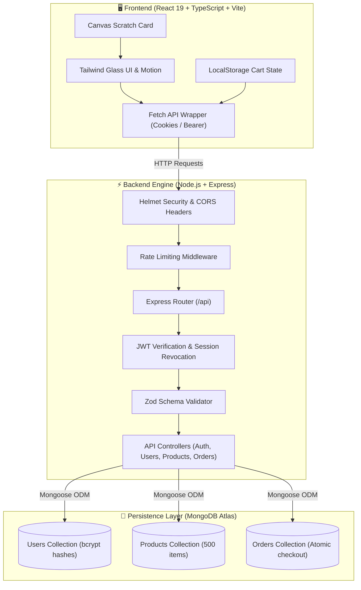
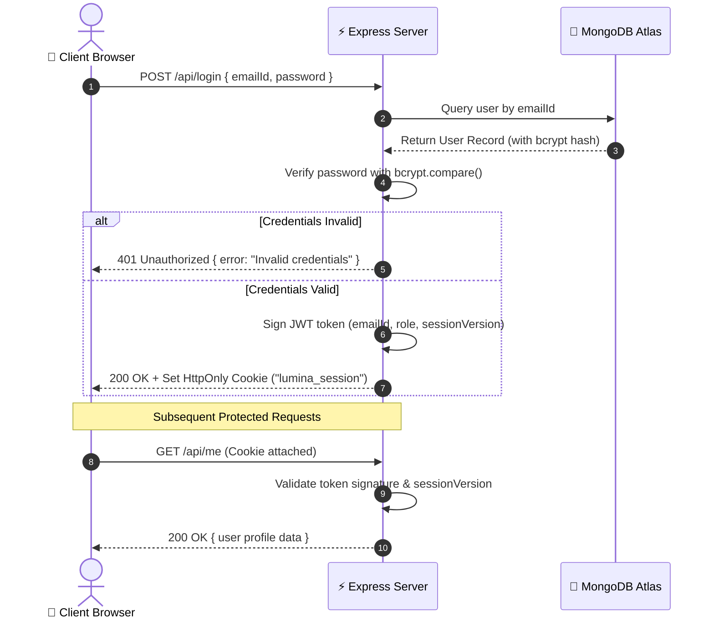

<div align="center">

# ⚡ NORTHSTAR SUPPLY
### High-Performance Full-Stack MERN E-Commerce & Management Platform

[](https://nodejs.org/)
[](https://react.dev/)
[](https://www.typescriptlang.org/)
[](https://expressjs.com/)
[](https://www.mongodb.com/)
[](https://tailwindcss.com/)
[](https://vercel.com/)
[](#-security--gitguardian-verification)

<p align="center">
  <b>A production-grade, secure, modern Web Application built for CS3801 Web Technologies Lab.</b>
  <br />
  Designed with modern Glassmorphism, JWT Authentication, MongoDB Persistence, Role-Based Access Control, and Serverless Edge Deployment.
</p>

[Explore Documentation](#-table-of-contents) • [System Architecture](#-system-architecture) • [API Explorer](#-interactive-api-reference) • [Setup Guide](#-quick-start)

---

</div>

## 📑 Table of Contents

- [✨ Key Features](#-key-features)
- [🏛️ System Architecture](#-system-architecture)
- [🔐 Security & GitGuardian Verification](#-security--gitguardian-verification)
- [📡 Interactive API Reference](#-interactive-api-reference)
  - [Authentication & Sessions](#1-authentication--session-endpoints)
  - [User Profile Management (Exercise-8)](#2-user-profile-crud-exercise-8-core)
  - [Product Catalog & Management](#3-catalog--product-operations)
  - [Checkout & Orders](#4-checkout--order-operations)
- [💻 Technical Stack](#-technical-stack)
- [📂 Project Directory Tree](#-project-directory-tree)
- [🚀 Quick Start & Installation](#-quick-start)
- [🚢 Deployment Guide](#-deployment-guide)
- [🎓 Course & Author Info](#-course--author-info)

---

## ✨ Key Features

<table>
  <tr>
    <td width="50%">
      <h3>🛍️ Contemporary Storefront</h3>
      <ul>
        <li><b>500+ Deterministic Products:</b> Pre-seeded rich catalog across multiple categories with deterministic asset rendering.</li>
        <li><b>Real-Time Search & Filters:</b> Instant category filtering, price range limits, and full-text keyword search.</li>
        <li><b>Canvas Scratch-Card:</b> HTML5 Canvas interactive scratcher revealing dynamic cart discount coupons.</li>
        <li><b>Persistent Cart:</b> Client-side synchronized local storage with atomic quantity updates.</li>
      </ul>
    </td>
    <td width="50%">
      <h3>🛡️ Security & Authentication</h3>
      <ul>
        <li><b>Enterprise Cryptography:</b> Passwords salted and hashed with <code>bcrypt</code> before database writes.</li>
        <li><b>Dual JWT Auth:</b> Supports both secure <code>HttpOnly</code> strict cookies and <code>Bearer</code> token authorization headers.</li>
        <li><b>Stateful Session Invalidation:</b> Database-backed <code>sessionVersion</code> counter allowing immediate instant logout and token revocation.</li>
        <li><b>Input Fortification:</b> Strict <code>Zod</code> runtime validation schemas preventing injection and malformed payloads.</li>
      </ul>
    </td>
  </tr>
  <tr>
    <td width="50%">
      <h3>👤 Profile Management (Exercise-8)</h3>
      <ul>
        <li><b>Complete CRUD Suite:</b> Implementation of <code>POST</code>, <code>GET</code>, <code>PUT</code>, <code>PATCH</code>, and <code>DELETE</code>.</li>
        <li><b>Ownership Authorization:</b> Users can only read, modify, and delete their own profile data.</li>
        <li><b>Data Integrity:</b> Unique email constraints and sanitization prevent duplicate accounts.</li>
      </ul>
    </td>
    <td width="50%">
      <h3>⚡ Modern Architecture & DX</h3>
      <ul>
        <li><b>End-to-End TypeScript:</b> Shared models between frontend components and backend Express services.</li>
        <li><b>Tailwind CSS v4:</b> Ultra-sleek dark glassmorphism aesthetic with responsive layouts.</li>
        <li><b>Serverless Ready:</b> Pre-configured Vercel Express bridge for low-latency serverless operation.</li>
      </ul>
    </td>
  </tr>
</table>

---

## 🏛️ System Architecture



### Authentication Lifecycle Flow



---

## 🔐 Security & GitGuardian Verification

> [!IMPORTANT]
> **Zero-Secret Guarantee:** This repository enforces rigorous hygiene against credential leakage. All historical commits have been sanitized, and strict `.gitignore` configurations protect active runtime configurations.

```
┌────────────────────────────────────────────────────────────────────────┐
│  GITGUARDIAN AUDIT CHECKLIST                                            │
│  ✔ History Rewritten via git-filter-repo                              │
│  ✔ Purged exposed credentials across all commits                       │
│  ✔ Zero occurrences of sensitive URIs or production passwords         │
│  ✔ .env excluded from version tracking                                 │
│  ✔ .env.example strictly contains placeholder variables                │
└────────────────────────────────────────────────────────────────────────┘
```

---

## 📡 Interactive API Reference

All endpoints are hosted at `/api`. Click any item below to inspect the interactive request/response payload specifications.

### 1. Authentication & Session Endpoints

<details>
<summary><b><code>POST</code> <code>/api/users</code> — Register Standard Account (201 Created)</b></summary>
<br>

**Request Body (`application/json`):**
```json
{
  "username": "Rithik Kumaran",
  "emailId": "rithik@example.com",
  "password": "SecurePassword123!",
  "address": "123 Tech Park, OMR, Chennai",
  "city": "Chennai",
  "pincode": "603110"
}
```

**Response (`201 Created`):**
```json
{
  "message": "User registered successfully.",
  "user": {
    "username": "Rithik Kumaran",
    "emailId": "rithik@example.com",
    "role": "user",
    "address": "123 Tech Park, OMR, Chennai",
    "city": "Chennai",
    "pincode": "603110",
    "createdAt": "2026-11-04T22:49:15.000Z"
  }
}
```
</details>

<details>
<summary><b><code>POST</code> <code>/api/login</code> — Authenticate & Issue Session (200 OK)</b></summary>
<br>

**Request Body (`application/json`):**
```json
{
  "emailId": "rithik@example.com",
  "password": "SecurePassword123!"
}
```

**Response (`200 OK`):**
```json
{
  "message": "Authentication successful.",
  "token": "eyJhbGciOiJIUzI1NiIsInR5cCI6IkpXVCJ9...",
  "user": {
    "username": "Rithik Kumaran",
    "emailId": "rithik@example.com",
    "role": "user"
  }
}
```
*Note: Also issues an `HttpOnly`, `SameSite=Strict` secure session cookie.*
</details>

<details>
<summary><b><code>POST</code> <code>/api/logout</code> — Terminate Active Session (200 OK)</b></summary>
<br>

**Response (`200 OK`):**
```json
{
  "message": "Session invalidated successfully."
}
```
</details>

---

### 2. User Profile CRUD (Exercise-8 Core)

<details>
<summary><b><code>GET</code> <code>/api/me</code> — Retrieve Authenticated Profile (200 OK)</b></summary>
<br>

**Headers:** `Authorization: Bearer <token>` or Cookie
```json
{
  "username": "Rithik Kumaran",
  "emailId": "rithik@example.com",
  "role": "user",
  "address": "123 Tech Park, OMR, Chennai",
  "city": "Chennai",
  "pincode": "603110"
}
```
</details>

<details>
<summary><b><code>PUT</code> <code>/api/users?emailId=...</code> — Complete Profile Replacement (200 OK)</b></summary>
<br>

**Query Parameter:** `emailId=rithik@example.com`  
**Request Body (`application/json`):**
```json
{
  "username": "Rithik Kumaran K",
  "address": "456 Innovation Boulevard",
  "city": "Chennai",
  "pincode": "600001"
}
```

**Response (`200 OK`):**
```json
{
  "message": "User profile replaced successfully.",
  "user": {
    "username": "Rithik Kumaran K",
    "emailId": "rithik@example.com",
    "address": "456 Innovation Boulevard",
    "city": "Chennai",
    "pincode": "600001"
  }
}
```
</details>

<details>
<summary><b><code>PATCH</code> <code>/api/users?emailId=...</code> — Partial Profile Update (200 OK)</b></summary>
<br>

**Query Parameter:** `emailId=rithik@example.com`  
**Request Body (`application/json`):**
```json
{
  "city": "Bengaluru"
}
```

**Response (`200 OK`):**
```json
{
  "message": "User profile updated successfully.",
  "user": {
    "username": "Rithik Kumaran K",
    "emailId": "rithik@example.com",
    "city": "Bengaluru"
  }
}
```
</details>

<details>
<summary><b><code>DELETE</code> <code>/api/users?emailId=...</code> — Delete Registration (200 OK)</b></summary>
<br>

**Query Parameter:** `emailId=rithik@example.com`  
**Response (`200 OK`):**
```json
{
  "message": "User registration permanently deleted."
}
```
</details>

---

### 3. Catalog & Product Operations

<details>
<summary><b><code>GET</code> <code>/api/products</code> — Retrieve Catalog (Public / Bearer)</b></summary>
<br>

**Query Parameters (Optional):**
- `category` (string, e.g. `Hardware`)
- `search` (string, e.g. `Mechanical Keyboard`)
- `sort` (`price-asc` | `price-desc` | `rating`)

**Response (`200 OK`):**
```json
{
  "total": 500,
  "products": [
    {
      "id": "prod-1",
      "name": "Northstar Precision Mechanical Keyboard",
      "category": "Hardware",
      "price": 149.99,
      "rating": 4.9,
      "stock": 42,
      "imageUrl": "/products/prod-1.svg",
      "description": "Custom CNC-milled aluminum chassis with hot-swappable switches."
    }
  ]
}
```
</details>

---

### 4. Checkout & Order Operations

<details>
<summary><b><code>POST</code> <code>/api/orders/checkout</code> — Atomic Checkout (201 Created)</b></summary>
<br>

**Request Body (`application/json`):**
```json
{
  "items": [
    { "productId": "prod-1", "quantity": 1 }
  ],
  "shippingAddress": {
    "fullName": "Rithik Kumaran",
    "addressLine": "123 Tech Park",
    "city": "Chennai",
    "pincode": "603110"
  },
  "discountCode": "SCRATCH15"
}
```

**Response (`201 Created`):**
```json
{
  "message": "Order placed successfully.",
  "orderId": "ORD-2026-98124",
  "totalAmount": 127.49,
  "status": "confirmed"
}
```
</details>

---

## 💻 Technical Stack

| Domain | Technology | Purpose |
| :--- | :--- | :--- |
| **Frontend Framework** | React 19 + TypeScript | High performance SPA with strictly-typed components |
| **Bundler & Server** | Vite 6 | Sub-second HMR and tree-shaken production bundles |
| **Styling** | Tailwind CSS v4 | Utility-first CSS, custom glass panels, and gradients |
| **Backend Runtime** | Node.js + Express 4 | RESTful routing and API controller lifecycle |
| **Database & ODM** | MongoDB Atlas + Mongoose | Distributed document storage, schema validation |
| **Security & Auth** | bcryptjs + jsonwebtoken | Cryptographic password hashing and session tokens |
| **Validation** | Zod | Runtime type safety and schema validation |
| **Testing Client** | Thunder Client / Postman | VS Code integrated API testing and verification |
| **Hosting** | Vercel | Production serverless edge hosting |

---

## 📂 Project Directory Tree

```bash
webtechlab/
├── 📁 api/                      # Vercel serverless function entrypoint
│   └── index.ts                 # Express serverless bridge
├── 📁 public/                   # Static public assets
│   ├── northstar-favicon.svg    # Vector application icon
│   └── 📁 products/             # Deterministic SVG product imagery
├── 📁 scripts/                  # Automation & asset generators
│   └── generate-product-images.mjs
├── 📁 src/                      # Client-side React source code
│   ├── 📁 components/           # UI components (Navbar, Cart, Profile, etc.)
│   ├── 📁 server/               # Mongoose schemas & database connection
│   │   ├── db.ts                # MongoDB connection & catalog seeder
│   │   └── 📁 models/           # User, Product, Order Mongoose schemas
│   ├── 📁 types/                # TypeScript interface declarations
│   ├── App.tsx                  # Main storefront view controller
│   └── main.tsx                 # Client bootstrap
├── .env.example                 # Environment configuration template
├── .gitignore                   # Version control security exclusion list
├── index.html                   # HTML entrypoint
├── metadata.json                # Project manifest
├── package.json                 # Dependencies and execution scripts
├── PROJECT_DOCUMENTATION.md     # In-depth architectural documentation
├── README.md                    # Interactive project guide
├── server.ts                    # Primary Express application server
├── tsconfig.json                # TypeScript compiler configuration
└── vite.config.ts               # Vite bundler build settings
```

---

## 🚀 Quick Start

### 1. Prerequisites
- [Node.js (v18+)](https://nodejs.org/)
- [Git](https://git-scm.com/)
- Active [MongoDB Atlas](https://www.mongodb.com/cloud/atlas) URI or local MongoDB server.

### 2. Clone the Repository
```bash
git clone https://github.com/RITHIKKUMARAN/webtechlab.git
cd webtechlab
```

### 3. Install Dependencies
```bash
npm install
```

### 4. Configure Environment Variables
Copy `.env.example` to create your local `.env`:
```bash
cp .env.example .env
```

Edit `.env` with your preferred editor:
```env
MONGODB_URI="mongodb+srv://<db_username>:<db_password>@<cluster-host>/northstar_supply?retryWrites=true&w=majority"
JWT_SECRET="generate-a-secure-random-secret-key-min-32-chars"
PORT=3000
APP_URL="http://localhost:3000"
```

### 5. Launch the Application
```bash
# Start local development server (Frontend + Backend)
npm run dev
```

Visit [`http://localhost:3000`](http://localhost:3000) in your browser.

---

## 🚢 Deployment Guide

### Vercel Serverless Deployment
1. Push your changes to GitHub.
2. Link the repository in your [Vercel Dashboard](https://vercel.com).
3. Set the following **Environment Variables** in Vercel settings:
   - `MONGODB_URI`: Your MongoDB connection string.
   - `JWT_SECRET`: Random key with 32+ characters.
   - `NODE_ENV`: `production`
4. Click **Deploy**. Vercel will bundle the Vite React client and deploy the Express API as a serverless function automatically!

---

## 🎓 Course & Author Info

- **Course:** CS3801 — Web Technologies Lab
- **Lab Exercise:** Exercise 8 (MERN Shopping Application & REST CRUD)
- **Institution:** Department of Computer Science and Engineering, **Shiv Nadar University Chennai**
- **Author:** **Rithik Kumaran K** ([@RITHIKKUMARAN](https://github.com/RITHIKKUMARAN))

---

<div align="center">
  <sub>Engineered with precision for modern web standards. Built with ❤️ at Shiv Nadar University Chennai.</sub>
</div>
